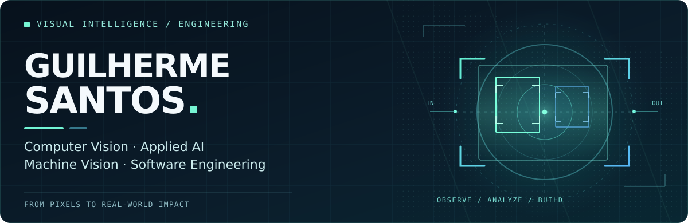

<!-- Profile README: GuilhermeSSantos2004/GuilhermeSSantos2004 -->

<p align="center">
  
</p>

<p align="center">
  <a href="https://www.linkedin.com/in/guilherme-silva-dos-santos-50762b216/">LinkedIn</a>
  &nbsp;·&nbsp;
  <a href="https://github.com/GuilhermeSSantos2004?tab=repositories">Open-source projects</a>
  &nbsp;·&nbsp;
  <a href="#selected-work">Selected work</a>
</p>

<h3 align="center">I build software that transforms visual information into useful intelligence.</h3>
<p align="center"><i>Computer Vision · Machine Vision · Applied AI · Edge AI · Software Engineering</i></p>

---

### `01 / ABOUT ME`

I'm **Guilherme Santos**, a developer working at the intersection of **Computer Vision, applied AI, and software engineering**. I enjoy going beyond running a model: understanding the problem, exploring mathematical and visual methods, validating ideas, and building the software that makes them useful.

At **Eyna**, I contribute to intelligent monitoring and AI-driven products. My public descriptions focus on the goals and engineering challenges of this work; proprietary implementation details remain private.

I'm also studying **Software Engineering at FIAP**.

> **My mindset:** don't just detect something in an image. Understand the problem, test the assumptions, and engineer a solution that works in the real world.

### `02 / WHERE I FOCUS`

| PERCEPTION | REASONING | ENGINEERING |
| :-- | :-- | :-- |
| Image processing, object detection, segmentation, visual analysis | Temporal patterns, mathematical methods, experiment design, evaluation | Backend APIs, cloud infrastructure, systems integration, efficient deployment |

```text
    VISUAL DATA             UNDERSTANDING             REAL-WORLD VALUE
   ─────────────   →   ───────────────────   →   ───────────────────
     Observe             Analyze & validate           Build & improve
```

### `03 / SELECTED WORK`

Some **public, collaborative or academic projects** that show the kind of problems I like working on:

| Project | What it explores |
| :-- | :-- |
| [**People Detection in Night Videos**](https://github.com/GuilhermeSSantos2004/detecao-pessoas-visao-noturna) | Visual detection under low-light conditions, with a focus on practical monitoring and assistance scenarios. |
| [**Face Gesture Automation**](https://github.com/GuilhermeSSantos2004/facial-gesture-detector) | Human-computer interaction through facial movement, connecting computer vision with physical devices. |
| [**Facial Analysis & Emotional Journal**](https://github.com/GuilhermeSSantos2004/facial-emotion) | A collaborative exploration of facial landmarks, visual signals, and local feedback interfaces. |

### `04 / MY ENGINEERING TOOLKIT`

**Vision & AI** `Python` · `OpenCV` · `Image Processing` · `Computer Vision` · `Applied AI`

**Systems & Delivery** `APIs` · `TypeScript` · `Docker` · `AWS` · `Software Architecture`

**Connected World** `IoT` · `Embedded Systems` · `Hardware–Software Integration`

### `05 / WHAT DRIVES ME`

- **Fundamentals first.** Mathematical intuition and careful experiments matter as much as choosing a model.
- **Constraints are part of the design.** Latency, robustness, and limited compute are engineering problems worth solving.
- **From prototype to product.** A great idea only becomes valuable when it can be integrated, maintained, and trusted.

---

<p align="center">
  <b>Let's connect over Computer Vision, applied AI, and engineering challenges.</b><br />
  <a href="https://www.linkedin.com/in/guilherme-silva-dos-santos-50762b216/">Connect with me on LinkedIn →</a>
</p>

<p align="center"><sub>From pixels to understanding. From understanding to impact.</sub></p>
